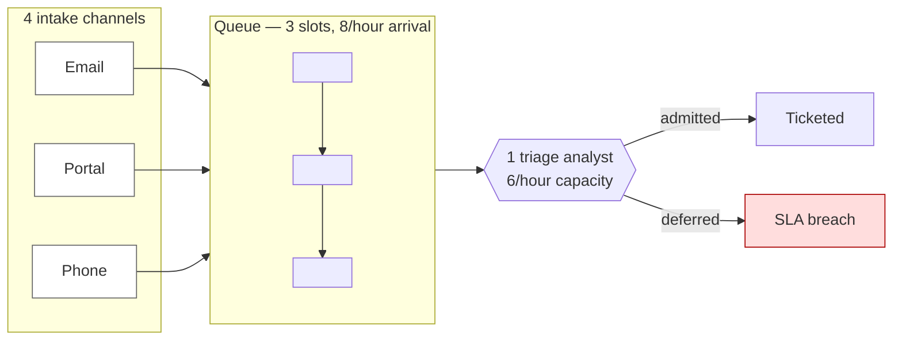
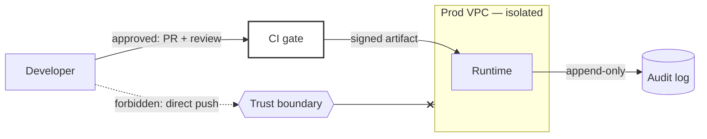
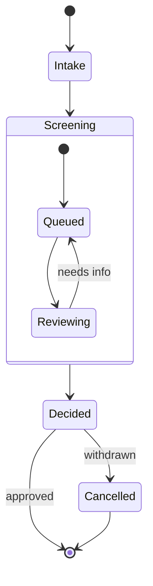

# Diagram grammars: patterns, budgets, and the static frame

Adapted from [`cathrynlavery/diagram-design`](https://github.com/cathrynlavery/diagram-design)
(MIT, © 2025 Cathryn Lavery), v2.6.110 — specifically `references/semantic-patterns.md` and
the complexity budgets in `references/layout-budget.md`. Upstream is a hand-authored SVG
engine: 45 pinned layout grammars with deterministic geometry, one editorial skin, and ~1.5 MB
of Python geometry linters. What is ported here is renderer-agnostic **discipline** — not its
renderer, not its skin, not its toolchain, not its per-type coordinate math.

**One deliberate divergence.** Upstream lists "reproducing Mermaid's renderer layout" as an
automatic-fail anti-pattern and requires hand-placed SVG. This skill is Mermaid-first, so that
row does not apply and is deliberately not copied. Everything below works with Mermaid, CSS
cards, HTML tables, and hand-drawn SVG alike.

## When to read this file

Read it before drawing any figure where **behaviour, state, enforcement, or risk is
load-bearing** — queues and bottlenecks, policy traces, trust boundaries, control catalogues,
defence layers, lifecycles. That is where plausible-but-wrong diagrams happen: the picture
looks right, reads smoothly, and misstates the system.

Skip it for a simple call tree, a file tree, a `diff`, or a plain pipeline — the ladder in
`SKILL.md` and `./inline-shapes.md` are enough.

---

## 1. Pattern before representation

`SKILL.md`'s "Choose the representation" table maps *content* → tool. This table maps
*what the reader must understand* → grammar. Pick the pattern first, then render it with
whichever representation the pattern names.

| The reader must understand… | Pattern | Render it as |
|---|---|---|
| Many arrivals competing for finite service capacity | **Fan-in queue / bottleneck** | `flowchart LR` with a queue `subgraph` |
| Repeated questions / inputs / controls / outputs across stages | **Stage framework with semantic slots** | HTML `<table>` (stage × slot matrix) |
| A loose conversation becoming a durable structured record | **Unstructured input → structured artifact** | card → transform node → field table |
| Why two policy decisions differ and where they first diverge | **Paired policy-evaluation traces** | HTML `<table>` of rule states, or two `flowchart TD` |
| Which routes cross a trust boundary and which are blocked | **Secure paved road** | `flowchart LR` + `subgraph` zones + `--x` blocked edges |
| Which controls apply at each enforcement surface | **Governance / control catalog** | HTML `<table>` grouped by enforcement surface |
| How defences reduce risk and what risk remains | **Compensating security layers** | CSS stacked layers or `flowchart TD` with a residual-risk carrier |
| Which sub-elements a system decomposes into, each independently citable | **Traceable block decomposition** | `mindmap` or CSS tree + a registry `<table>` |
| How one subject progresses through phases, waits, retries, cancellation | **Lifecycle phase map** | `stateDiagram-v2` with composite states |

Use **one** primary pattern per figure. A second pattern may contribute at most one supporting
element; if both need full treatment, split into overview + detail.

---

## 2. The nine patterns

Each pattern is: choose when → required elements → budget → anti-patterns → static frame.
The budget is a hard ceiling. Hitting it means splitting the figure, never shrinking the text.

### 2.1 Fan-in queue / bottleneck

**Choose when** several producers converge on one reviewer, service, gate, or constrained
resource, and the story depends on arrival rate, queue depth, wait, capacity, or backpressure.

**Required elements** distinct sources; fanned ingress; an ordered queue with visible slots and
a count; a capacity / service-rate label; one constrained service point; admitted **and**
deferred/rejected outcomes. Label units — `8/hour`, `3 slots` — not just "high".

**Budget** ≤5 sources, ≤5 queue slots, 1 bottleneck, 2 outcomes, ≤9 primary nodes. Aggregate
excess sources into one named cohort ("14 regional offices" as a single node).

**Anti-patterns** equal-width pipeline that hides contention; arrows merged before they can be
traced; capacity implied only by box size; decorative pile-up; animation that changes item
order; red alone meaning "overloaded".

**Static frame** the representative final queue, numeric count/capacity, the bottleneck label,
and both outcome paths. A still must reveal *why work waits*.

### 2.2 Stage framework with semantic slots

**Choose when** a lifecycle or operating model repeats the *same semantic questions* across
stages — commonly Question, Input, Governance, Output — and cross-stage comparability matters
more than message timing.

**Required elements** ordered stage headers; a consistent slot grid; **explicit
empty / not-applicable slots**; stage-to-stage handoff; stable slot labels; one primary output
per stage. Preserve slot order in every stage.

**Budget** 3–6 stages, 3–4 slot kinds, ≤20 populated cells, ≤2 lines per cell. Split when a
cell needs prose.

**Anti-patterns** each stage inventing its own internal layout; slot meaning encoded by
position with no labels; fake precision from dozens of cells; confusing stage order with
ownership lanes (that is a swimlane); shrinking text to keep one canvas.

**Static frame** the full stage × slot matrix with handoffs and explicit `—` entries.

This pattern is a table, not a diagram — render it as a semantic HTML `<table>` with the slots
as rows and stages as columns (or the reverse if that reads better).

### 2.3 Unstructured input → structured artifact

**Choose when** dialogue, notes, prompts, or a rambling request are elicited, normalised, and
written into a durable brief, ticket, record, or schema.

**Required elements** source utterance(s); clarifying questions; extracted field/value pairs;
a **named** transformation; the durable artifact boundary; provenance links from
representative statements to fields; missing/unknown state.

**Budget** ≤4 exchanges, ≤6 artifact fields, 1 transformation, ≤3 provenance links. Show
representative content, not a transcript.

**Anti-patterns** "AI magic" sparkle between two boxes; the artifact drawn as another chat
bubble; fields appearing without sources; inventing certainty for missing facts; a typing
animation as the only readable copy.

**Static frame** a short source excerpt beside the completed labelled artifact, at least one
provenance mapping, and unknown fields visible.

### 2.4 Paired policy-evaluation traces

**Choose when** two otherwise similar requests reach different outcomes and the reader needs
rule-by-rule `PASS` / `FAIL` / `SKIPPED` / `NOT REACHED` state plus the first divergence.

**Required elements** the same ordered rules on both traces; explicit status **text plus**
symbol/shape; inputs that differ; final outcomes; a labelled first-divergence marker; the
distinction between `SKIPPED` (applicable flow intentionally bypassed) and `NOT REACHED`
(evaluation stopped earlier).

**Budget** exactly 2 traces, 3–6 rules, 1 first divergence, ≤12 status cells, 1 outcome per
trace. Move rule prose to notes when labels exceed one line.

**Anti-patterns** comparing two independently ordered flows; green/red dots without words;
treating skipped and not-reached as synonyms; highlighting every difference; continuing a
denied trace as if downstream rules ran.

**Static frame** all rule states and both outcomes at once, with a persistent bracket or row
marker for the first divergence.

Prefer an HTML `<table>` — rule as row, one column per trace, status as text + colour + glyph.

### 2.5 Secure paved road

**Choose when** a supported architecture creates a bounded route from intake/build to
deployment, and trust boundaries, privileged moments, permitted ingress, forbidden ingress,
and approved-vs-blocked deploy paths are the point.

**Required elements** labelled trust boundaries; actors and identities; permitted ingress with
a positive text label; forbidden ingress **terminating at** the boundary; approved deployment
path; blocked bypass path; privileged gate; isolated runtime; audit destination. Use different
line styles and stop symbols *in addition to* colour.

**Budget** ≤3 trust zones, ≤8 components, ≤10 paths, ≤2 forbidden paths, 1 privileged gate.
Split control detail into a separate catalogue figure.

**Anti-patterns** a dashed box called "security" with no route semantics; a forbidden arrow
crossing into the protected zone; secrets or identity implied but unlabeled; every component
styled as trusted; a bypass path that visually rejoins the approved route.

**Static frame** every boundary and both permitted/forbidden routes, with blocked paths
visibly stopping **before** entry or deployment.

Mermaid gives you the stop semantics directly: `A --x|blocked| Z` ends the edge in a cross.
Never let a blocked edge reach its target node.

### 2.6 Governance / control catalog

**Choose when** a control inventory must be understood by *where it is enforced* — authoring,
workspace, merge/CI, deploy/runtime — and a flat checklist would hide those enforcement points.

**Required elements** enforcement-surface groups; named controls; enforcement actor
(`code` / `platform` / `human`); timing (`write` / `merge` / `deploy` / `run`); bypassability
or exception route; coverage/gap notation.

**Budget** 3–5 surfaces, 3–7 controls per surface, ≤24 controls total, ≤3 attributes per
control. Summarise counts only when the item list exists elsewhere.

**Anti-patterns** 35 tiny pills; grouping by vague themes instead of enforcement point; mixing
aspirations with enforced controls; icons without control names; claiming defence-in-depth
without showing surface coverage.

**Static frame** the complete grouped catalogue with surface headers and text labels for actor
and timing; preserve gaps and exceptions.

Render as an HTML `<table>` grouped by surface, or CSS cards with one card per surface. Not a
Mermaid graph — a catalogue is data, and tables beat graphs for data.

### 2.7 Compensating security layers

**Choose when** no layer is perfect: each defence covers a failure left by the previous layer,
and residual risk must visibly narrow, transfer, or remain through the stack.

**Required elements** ordered threat/risk input; named defensive layers; each layer's
mitigation; explicit limitation or escape; a residual-risk **carrier** between layers; final
residual risk and consequence/response. Use labels or decreasing measures — never area alone.

**Budget** 3–5 layers, 1 primary risk thread, ≤2 mitigations per layer, 1 final residual-risk
statement. Split multiple unrelated threats into separate figures.

**Anti-patterns** implying the final layer makes risk zero; equal opaque slabs with no
propagation; treating audit as prevention; shrinking shapes without numeric or verbal meaning;
reversing prevention/detection/recovery order without explanation.

**Static frame** the complete propagation chain: initial risk → mitigation → escaped risk at
every layer → final residual risk and response.

### 2.8 Traceable block decomposition

**Choose when** a system must decompose into addressable, individually citable sub-elements —
each with a stable identifier a reader (or a compliance, audit, or IP record) can point at
directly, not a name alone — and each traceable to its parent, its inputs/outputs, and the
code that implements it. This describes **structure**; for a sequence of actions use 2.4,
2.7, or a plain flowchart instead.

**Required elements** a stable dotted ID per block (`PAY-001-02`) shown as a compact badge,
never as a separate connector-adjacent label; a **noun-phrase** block name (the structural
element, "Fraud Screening", not an action performed on it); parent-child structure; at most one
short inbound and one short outbound flow-port label per block, omitted by default. Every
block's full record — inputs, outputs, constraints, assumptions, implementation path — lives
in `data-block-*` attributes on the node and in a sidecar registry table, never as additional
visible diagram text.

**Budget** the universal 9-node ceiling applies as-is. A hierarchy that needs more splits into
a linked set of figures, one per subsystem; the registry is what reassembles the full graph
across files. Constraints and assumptions are never rendered as visible text.

**Anti-patterns** four-sided ICOM boxes with Input/Control/Output/Mechanism arrows on every
side (that is IDEF0's grammar, and it does not fit a tree); input/output arrows between
siblings or cousins (that is a dependency graph — route there if cross-block flow must be
drawn); verb-phrase block names; an ID badge with no matching `data-block-id`; treating the
visible diagram as the complete record.

**Static frame** always static — every ID badge and block name legible in one rendered frame.
Click-to-expand and filter-by-ID are out of scope for this pattern.

`mindmap` is the right Mermaid shape because it has no arrows to invent semantics with;
`stateDiagram-v2` and dependency graphs permit multi-parent nodes and cycles this pattern
forbids.

Provenance note: "block" and "flow port" are SysML Block Definition Diagram vocabulary, used
because this pattern documents structure. It is SysML-*informed*, not SysML-compliant — no
OCL constraints, no XMI interchange, no tool-certified conformance.

### 2.9 Lifecycle phase map

**Choose when** one subject advances through a small set of named phases, and waits, retries,
cancellation, recovery, and terminal outcomes matter as much as the happy path. Use it for the
subject's lifecycle, **not** for messages exchanged between actors — that is `sequenceDiagram`.

**Required elements** a primary phase rail; 4–5 ordered phase states; a separate
interruption/recovery grouping for waits or retries; a separate terminal-outcome grouping;
labelled transitions; distinct terminal states for cancellation and failure when both can
occur.

**Budget** 4–5 primary phases, ≤2 supporting wait/recovery states, ≤2 terminal states,
≤9 states, ≤10 transitions. Split lifecycle overview from dense guard logic at either ceiling.

**Anti-patterns** actor lifelines or message arrows disguised as phases; a request/response
exchange that belongs in `sequenceDiagram`; every guard and event from the underlying
implementation; interruption states placed on the primary rail; cancellation and failure
collapsed into one colour-only state; a retry loop with no labelled re-entry point.

**Static frame** the complete rail, every supporting state, both terminal outcomes, and all
labelled transitions in one frame. Position and grouping labels must distinguish progress,
interruption, and termination without relying on colour.

`stateDiagram-v2` composite states give you the three bands directly:

---

## 3. Complexity budgets

### Universal caps (every figure)

| Limit | Cap |
|---|---|
| Primary nodes | 9 |
| Arrows / transitions | 12 |
| Focal accent elements | 2 |
| Annotation callouts | 2 |

### Per-shape caps

| Shape | Cap |
|---|---|
| `sequenceDiagram` lifelines | 5 |
| `sequenceDiagram` combined fragments | 1 (2 only if each is a single-region `opt`/`loop`) |
| `sequenceDiagram` `alt` regions / nesting | 2 / 1 |
| Swimlanes | 5 |
| `quadrantChart` items | 12 |
| `erDiagram` entities | 8 |
| Nesting levels | 6 |
| Tree depth / nodes per level | 4 / 5 |
| `mindmap` depth | 4 |
| Layer stack | 6 |
| `venn-beta` circles | 3 |
| Pyramid / funnel layers | 6 |
| `radar-beta` axes / series | 5 / 5 |
| Bar chart bars | 8 |
| Waterfall bars | 8 incl. totals, 1 subtotal |
| `treemap` cells | 8 |
| Line chart series | 5 |
| `gantt` tasks | 12 |
| Scatter points | 30 |
| `sankey-beta` stages / nodes / flows | 3 / 8 / 12 |
| Fishbone (`ishikawa-beta`) | 6 bones, 3 sub-causes each |
| Wardley components / links / movement arrows | 9 / 12 / 2 |
| `kanban` columns / cards | 5 / 12 total, 4 per column |
| `journey` stages / rows / pain markers | 6 / 3 / 2 |
| Deployment zones / nodes / paths | 3 / 6 / 8 |
| Dependency nodes / edges / ranks / cycles | 9 / 14 / 4 / 1 |
| `classDiagram` classes / relationships | 7 / 8, ≤5 members per compartment |
| Story map activities / slices / cards | 5 / 3 / 12 |
| DB schema tables / columns shown / FKs | 5 / 8 / 6 |
| HTML `<table>` (any matrix) | 6 columns before splitting; no fixed heights |

**Exceed a cap → split into two figures (overview + detail), linked from one page.** Never
shrink type, never drop a label, never exceed to keep one canvas. A pattern's own budget in §2
can only tighten these.

### Structural geometry

Keep node origins, widths, heights, gaps, and padding on a 4px grid. Off-grid by design: type
sizes, radii, data-derived positions, text baselines, stroke widths, opacity. This matters most
for hand-authored SVG and CSS card grids; Mermaid owns its own spacing.

---

## 4. The remove test

Run it before delivering any figure:

- Can I **remove** any node and still have the reader understand?
- Can I **merge** any two nodes that always travel together?
- Can I **remove** any arrow whose relationship is already obvious from layout?
- Can I **remove** any label whose meaning colour or shape already carries?

If the answer to any is yes, do it and re-check the budget.

---

## 5. The static-frame rule

**Every figure must be complete and legible in one still frame** — no hovering, no clicking, no
waiting for an animation step, no zooming.

This skill mandates zoom/pan/expand controls on Mermaid diagrams and allows entrance animation;
that is a *navigation* layer, never the carrier of meaning. Concretely:

- All labels, states, and outcomes visible without interaction.
- Anything an animation reveals must already be present in the initial frame, or duplicated as
  text.
- A screenshot at desktop width and at 390 px must each tell the whole story on their own —
  which is why `SKILL.md`'s final checklist requires capturing and reading those PNGs.
- `prefers-reduced-motion` must leave the figure fully readable, not blank.

---

## 6. Semantic anti-patterns (meaning, not styling)

`SKILL.md` and `./css-patterns.md` cover the styling side (neon glow, default violet, equal
cards, shadows). These are the meaning-side failures — the diagram is pretty and wrong:

| Anti-pattern | Why it fails |
|---|---|
| Identical boxes for every node | Erases hierarchy; nothing says what matters |
| Colour alone carrying state | Fails colour-blind readers and greyscale print; add text or shape |
| Accent colour used as a signalling system | Focal accent is 1–2 elements, not "everything important" |
| Capacity or quantity implied by box size | Unmeasurable; put the number in a label |
| Legend floating inside the diagram area | Collides with nodes; put it below or in the page chrome |
| Legend that omits a type used, or lists one unused | Reader cannot decode, or decodes wrongly |
| Arrow labels with no masking background | Text bleeds through the line it labels |
| Vertical `writing-mode` text on arrows | Unreadable |
| A blocked/forbidden edge that reaches its target | States the opposite of what you mean; stop it at the boundary |
| Two flows merged before they can be traced | Hides which producer hit the bottleneck |
| Shrinking shapes to imply reduction with no number | Area is not a quantity the reader can read |
| Audit/detection drawn as prevention | Misstates the control's function |
| Prose paragraphs inside nodes | If it needs prose it needs a table or a card, not a diagram |
