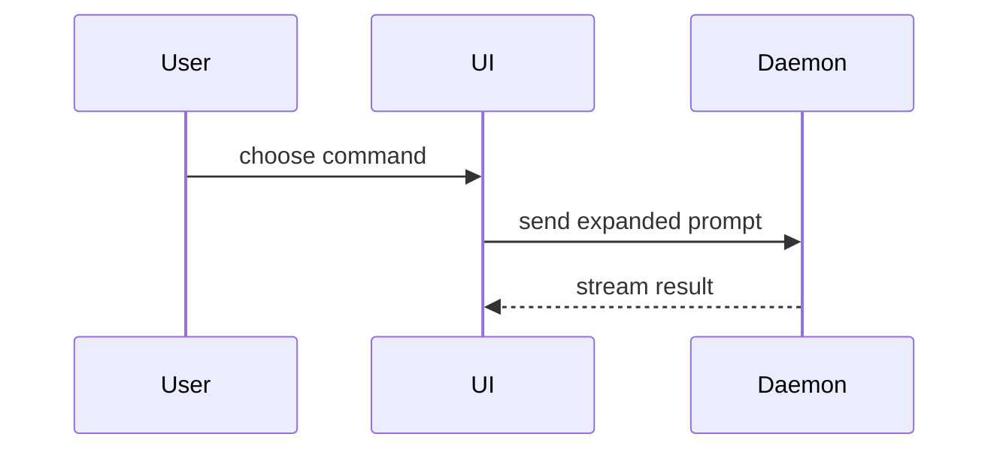

# Inline Shapes

Worked examples for the smallest-view-first ladder in `SKILL.md`. Most "show me",
"explain this", "what changes" requests are answered better by a fenced block in
chat than by an HTML file. Pick the smallest shape that carries the point.

Adapted from humanlayer's MIT-licensed [`show-me`](https://github.com/humanlayer/skills/tree/main/plugins/show-me).

---

## Pseudocode — logic, algorithm, event handler

```text
on(save)
  if content is unchanged
    return cached result
  write new content
  return fresh result
```

## Call tree — runtime control flow

```text
submitForm
  createSession
    persistPrompt
    launchAgent
  navigateToSession
```

## Component tree — UI structure

Include the state and module boundaries that matter, and the path or package
that owns each part.

```tsx
<SessionPage> (apps/example/src/routes/session.tsx)
  useSessionEvents()
  <SessionToolbar>
    <RunSkillButton> (packages/ui)
```

## Shallow file tree — file responsibility, broad refactor

Annotate with the responsibility, not the file list.

```text
src/
├── commands/       # parses user actions
├── sessions/       # owns session state
└── transport/      # sends API requests
```

## Mermaid — interaction, control flow, data flow



In chat, a bare `mermaid` fence is fine. In an HTML page, apply the
`diagram-shell` + zoom/pan invariants from `SKILL.md`.

## `diff` — what changes to a shape that already exists

Match the diff shape to the topic; the same notation carries all four:

Component change:

```diff
 <SessionPage>
   useSessionEvents()
   <SessionToolbar>
+    <RunSkillButton />
   <SessionTimeline>
+    <SkillResultCard />
```

File-layout change:

```diff
 src/
 ├── commands/
+│   └── show-me.ts       # expands the slash command
 ├── sessions/
-└── transport.ts
+└── transport/
+    ├── client.ts
+    └── stream.ts
```

Call-tree change:

```diff
 submitForm
   createSession
     persistPrompt
+    expandSkillMention
     launchAgent
-  navigateToSession
+  navigateToSession
+    subscribeToEvents
```

Control-flow change:

```diff
 on(save)
-  write content
+  if content is unchanged
+    return cached result
+  write new content
+  invalidate cache
```

## Full block — the whole shape

Use a complete language-tagged block instead of a diff when most of it is new,
when omitted context would hide ownership or order, or when the user needs a
copyable target shape.

```ts
function expandSkill(command: string): string {
  const skillName = command.slice(1)
  return `use the ${skillName} skill`
}
```

## HTML page — only when chat cannot carry it

Reach for the page when the point needs layout, colour-coded density, zoom/pan,
side-by-side comparison, or a shareable artifact: a visual UI or layout, a state
comparison, a 4+ row matrix, a 15+ element architecture, a slide deck, or a
concept too dense for Mermaid. Follow the rest of `SKILL.md`.

---

## Placement and restraint

- Place each shape next to the short text it supports, not in a wall of prose.
- You may use one shape, you may use several; it is unlikely you need all of
  them. Do not overwhelm the reader.
- Keep only the calls, files, props, states, and boundaries needed to answer the
  current question — trim everything a reader can find in the repo themselves.
- Escalate rather than pre-empt: start at the cheapest rung, and only write the
  file when the chat shapes demonstrably do not fit.
